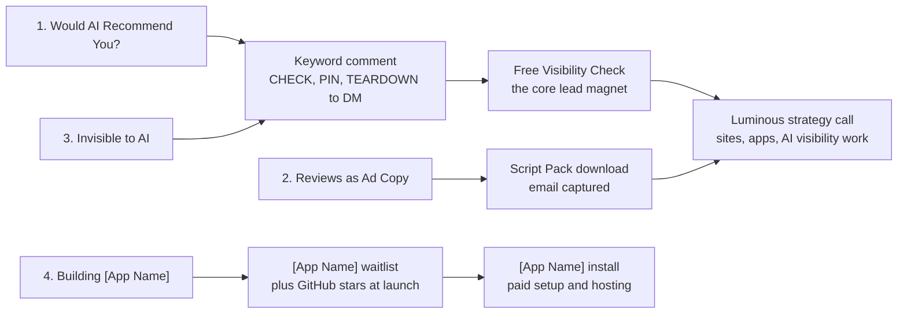

# AI Visibility Content Series — Luminous

Nov 4, 2026 · Samuel Godfrey

## Strategy and funnel

Four content series run in parallel, each teaching local service businesses and SMB owners one lever that decides whether AI assistants recommend them. Every series ends in the same three destinations: a free AI Visibility Check, a Luminous strategy call, and the [App Name] waitlist.

**The core idea.** When someone asks an AI assistant for "wash and fold in San Diego", the answer is assembled from ratings, review volume, what reviews actually say, and how complete the business profile is. A business with 5 stars from 2 reviews gets skipped; one with 5 stars from 1,900 reviews gets recommended. A business with no public address can drop off the map entirely. This is the story every series tells from a different angle.

**What each post must do.**

- Teach one fix a business owner can act on this week, so the post earns saves and shares.
- Show Luminous as the team that understands how AI picks winners, so readers ask for help.
- Point toward [App Name] as the tool that tracks it, so the open-source launch has an audience waiting.

**The four series.**

| Series | Lever it teaches | Funnel role | Main CTA |
| --- | --- | --- | --- |
| 1. Would AI Recommend You? | How AI picks local businesses | Reach and awareness | Comment "CHECK" for a free AI Visibility Check |
| 2. Your Reviews Are Your New Ad Copy | Review volume and review content | Trust and saves | Download the Review Request Script Pack |
| 3. Invisible to AI | Business profile completeness | Leads | Book a free AI Visibility Check |
| 4. Building [App Name] in Public | Tracking AI Overviews over time | App launch and install sales | Join the waitlist, star the repo, book installation |

**How the app fits.** [App Name] is open source and free to self-host. Luminous sells the convenience: installation, configuration, hosting and monthly reporting for businesses without a developer. This is the same model Plausible, Cal.com and n8n use, where free code builds trust and reach and the paid service turns that reach into revenue. Series 1 to 3 create the problem awareness; Series 4 introduces the tool that solves it.

**Guardrails.** Never recommend buying, faking or gating reviews; it breaks Google's policies and the FTC's 2024 rule on fake reviews. Never name and shame real businesses; anonymize weak examples and only name businesses held up as good examples.

## Virality testing system

No post can be proven viral before it goes live, so every post passes two tests: a pre-publish score of 22 out of 30 or higher, then a live hook test where the best-performing hook gets reposted and boosted.

**Test 1: Pre-publish score.** Score each criterion from 1 to 5. Anything under 22 gets rewritten before it ships.

| Criterion | What a 5 looks like |
| --- | --- |
| Hook | The first line stops the scroll and creates a gap the reader needs to close |
| Specificity | A real number, city, category or result, not a general claim |
| Identity | A business owner reads it and thinks "this is about me" |
| Utility | Worth saving: a fix, script or checklist they can use today |
| Comment trigger | A question, keyword CTA or mild contrarian take that invites replies |
| Image stop power | The image makes sense in one second without the caption |

**Test 2: Live hook test.** Every post in this doc ships with three hooks.

1. Post Hook A on LinkedIn and Hook B on X at the same hour on the same day.
2. After 90 minutes, compare engagement rate (reactions + comments + shares, divided by impressions).
3. Use the winning hook for the Instagram, Facebook and TikTok versions.
4. Put a small paid boost behind any post that beats your 30-day average engagement rate by 50% or more.
5. Log every result. After four weeks, the hook patterns that win become the template for new posts.

**Comment-to-DM keywords.** Posts that ask readers to comment a keyword ("CHECK", "SCRIPT", "WAITLIST") get more comments, which the platforms reward with reach, and every commenter becomes a lead to message. On Instagram and Facebook, automate the DM reply; on LinkedIn and X, reply by hand for the first hour.

## Series 1: Would AI Recommend You?

Real experiments where you ask AI assistants for a local service and break down why the winners won. This is the reach engine: the format is curiosity-driven, easy to repeat across any industry and city, and every episode ends with a free AI Visibility Check. Run it twice a week.

### Post 1.1: The laundry experiment

- **Hook A:** I asked AI for a wash and fold in San Diego. It skipped a business with a perfect 5-star rating.
- **Hook B:** 5 stars from 2 reviews lost to 5 stars from 1,900. Here's how AI decided.
- **Hook C:** AI just chose which laundromat gets the customer. Would it choose you?

**Post:** I searched for a wash and fold service in San Diego using an AI assistant. It returned ten businesses and recommended four. Three things decided who made the cut. Volume: a 5-star rating from 2 reviews was barely mentioned, while 5 stars from nearly 1,900 reviews was treated as proof. Review content: the AI described one service as letting you pick your detergent and drying settings. That came from customer reviews, not the business's website. Profile completeness: two good delivery services had no public address, so they never appeared on the map. Your customers are asking AI the same question about your business right now.

**CTA:** Comment CHECK and we'll tell you whether AI recommends your business, free.

**Image:** A phone screen showing an AI answer listing local laundry services, with three bold callouts pointing at it: "Review volume", "What reviews say", "Address on file". Dark background, one accent color.

**Score: 25/30** (Hook 5, Specificity 5, Identity 4, Utility 3, Comment 4, Image 4). Utility is the weak spot; the carousel version adds a fourth slide with the three fixes to lift saves.

### Post 1.2: The 10-second test

- **Hook A:** Open any AI assistant and type your service plus your city. Are you in the answer?
- **Hook B:** Most business owners have never Googled themselves through AI. Try it now.
- **Hook C:** Your next customer won't scroll Google. They'll ask AI. Here's how to see what it tells them.

**Post:** Do this before you finish your coffee. Open ChatGPT, Gemini or Google and search the way a customer would: "best [your service] in [your city]". Then check three things. Are you named at all? Is what it says about you accurate? Who did it recommend instead, and what do they have that you don't? Reply with IN or OUT. We'll go through the OUTs and tell you what's holding you back.

**CTA:** Reply IN or OUT.

**Image:** A bold two-panel graphic. Left: a search bar with "best plumber in Phoenix" typed in. Right: two large stamps, "IN" in green and "OUT" in red. Text overlay: "Did AI pick you?"

**Score: 25/30** (Hook 4, Specificity 3, Identity 5, Utility 4, Comment 5, Image 4). The IN/OUT reply is the strongest comment trigger in the plan; on LinkedIn, pin a comment with your own result to start the thread.

### Post 1.3: AI Visibility Teardown (recurring)

- **Hook A:** We asked AI about a real local business. Here's what it got wrong, and the fix.
- **Hook B:** This dentist has 4.8 stars. AI still recommends their competitor. Here's why.
- **Hook C:** Free teardown: how AI sees one local business, line by line.

**Post:** Each week, one business volunteers (from the CHECK comments) and you publish its teardown with permission: what AI says about it, which competitor it recommends instead, the three gaps that explain the difference, and the fix for each. Name the volunteer, tag them, and keep it constructive. They'll share it, which brings their audience to you.

**CTA:** Want your business torn down next? Comment TEARDOWN.

**Image:** A scorecard graphic with the business's logo (with permission), a score out of 100, and three red-to-green bars: Reviews, Review content, Profile.

**Score: 24/30** (Hook 4, Specificity 5, Identity 4, Utility 4, Comment 4, Image 3). The scorecard image needs to be a reusable template so each week takes minutes, not hours.

## Series 2: Your Reviews Are Your New Ad Copy

Practical posts showing that AI assistants describe a business using its reviews, so the words customers write have become its advertising. This series earns saves and builds the email list through the Review Request Script Pack. Run it once a week.

### Post 2.1: Your customers are writing your AI description

- **Hook A:** AI described a laundry service in detail. None of it came from their website.
- **Hook B:** Your marketing copy matters less than you think. Your reviews matter more.
- **Hook C:** Read your last 10 reviews. That's roughly what AI will tell customers about you.

**Post:** When an AI assistant recommended a San Diego laundry service, it said customers could choose their detergent and drying settings and get text updates. That detail came from reviews. A review that says "great service!" gives AI nothing to work with. A review that says "they picked up my comforters on Saturday and had them back Sunday, perfectly folded" tells AI exactly what you do, when, and how well. You can't write your reviews, but you can make it easy for happy customers to be specific.

**CTA:** Comment SCRIPT and we'll send you the exact message that gets customers to write detailed reviews.

**Image:** Two review cards side by side. Left, faded: "Great service! 5 stars." Right, highlighted: a detailed review mentioning service, timing and result. Caption across the top: "Which one does AI quote?"

**Score: 26/30** (Hook 5, Specificity 4, Identity 5, Utility 4, Comment 4, Image 4).

### Post 2.2: Stop asking for "a quick review"

- **Hook A:** "Could you leave us a quick review?" is costing you customers. Here's what to send instead.
- **Hook B:** Copy this message. It gets reviews that AI can actually use.
- **Hook C:** The review request script we give every Luminous client.

**Post:** Asking for "a quick review" gets you quick reviews: five stars, four words, no detail. Ask a better question instead. Text sent within 24 hours of the job: "Hi [Name], thanks for choosing us for [service]. If you have a minute, would you share what we did and how it went? It helps neighbors find us. [link]". Asking what you did and how it went prompts specifics without telling anyone what to say. Send it to every customer, not only the happy ones, and never offer a discount for a review.

**CTA:** Comment SCRIPT for the full pack: text, email and in-person versions.

**Image:** A phone with a text message bubble showing the script, the key phrase "what we did and how it went" highlighted. Small label: "Copy this."

**Score: 27/30** (Hook 5, Specificity 4, Identity 4, Utility 5, Comment 5, Image 4). The highest-scoring post in the plan; lead with it in week one.

### Post 2.3: One bad review isn't the problem

- **Hook A:** One bad review won't sink you. Ignoring it might.
- **Hook B:** How to answer a 1-star review so new customers trust you more.
- **Hook C:** A business with 4.6 stars and great replies can beat a 4.9 that never responds. Here's why.

**Post:** Customers read your replies, and anything that summarizes your profile can read them too. A calm, specific reply to a bad review shows how you handle problems, which is what a cautious new customer wants to know. Use three steps: thank them and name the issue, explain what you changed, and invite them to contact you directly. Keep it under 60 words and never argue in public.

**CTA:** Comment REPLY for our template for answering negative reviews.

**Image:** A 1-star review card with a short, professional owner reply beneath it, the three steps labeled 1, 2, 3 in the margin.

**Score: 23/30** (Hook 4, Specificity 3, Identity 4, Utility 5, Comment 3, Image 4). Hook C is the boldest option and should be tested first; keep its comparison framed as "can", since it's a pattern, not a guarantee.

## Series 3: Invisible to AI

Short, fix-focused posts on the profile gaps that make a business hard for AI to find, describe or place on a map. This is the main lead generator: each post shows a problem most owners can't diagnose alone, then offers the free AI Visibility Check. Run it once a week.

### Post 3.1: The missing pin

- **Hook A:** Two of the best-reviewed laundry services in San Diego didn't show up on the AI's map. Here's why.
- **Hook B:** Great reviews, great service, invisible on the map. One setting causes it.
- **Hook C:** If you work from home or on the road, AI may not know where you are.

**Post:** When an AI assistant mapped wash and fold services in San Diego, two highly rated pickup-and-delivery businesses were missing. They had no public address, so there was nowhere to put a pin. If you serve customers at their location (cleaners, plumbers, mobile detailers, tutors), set yourself up as a service-area business in Google Business Profile, list every neighborhood or ZIP code you cover, and keep your hours and phone number current. You keep your home address private and still tell AI where you work.

**CTA:** Comment PIN and we'll check how your business appears on maps and in AI answers.

**Image:** A city map with several pins and two faint, dashed "ghost" pins labeled "Not found". Headline: "Is your business a ghost pin?"

**Score: 25/30** (Hook 5, Specificity 5, Identity 4, Utility 4, Comment 3, Image 4).

### Post 3.2: The 15-minute profile audit

- **Hook A:** 15 minutes. 7 checks. The profile fixes that help AI recommend you.
- **Hook B:** Save this. It's the checklist we run before every client's AI visibility work.
- **Hook C:** Your Google profile is probably 60% finished. Here's the other 40%.

**Post:** Run these seven checks on your Google Business Profile today. One: the primary category matches what customers search for. Two: secondary categories cover every service you offer. Three: each service is listed with a one-line description. Four: regular and holiday hours are set. Five: at least ten recent photos of real work. Six: your website link works and loads fast on a phone. Seven: your name, address and phone number match exactly on Yelp, Apple Business Connect and Bing Places. Every "no" is a gap AI has to guess about.

**CTA:** Got more than two "no"s? Book a free AI Visibility Check: link in comments.

**Image:** A clean checklist graphic with seven boxes, three ticked in green and four empty. Title: "The 15-minute AI profile audit." Instagram version: a 9-slide carousel, one check per slide.

**Score: 26/30** (Hook 4, Specificity 4, Identity 4, Utility 5, Comment 4, Image 5). Hook C's "60%" is a figure of speech, not data; swap in a real number once your Visibility Checks produce one.

### Post 3.3: Three versions of you

- **Hook A:** Your website, Google and Yelp each say something different about your business. AI notices.
- **Hook B:** We found three different phone numbers for one local business. Guess which one AI used.
- **Hook C:** Moved, changed hours, or added a service? Here's where you forgot to update it.

**Post:** AI assistants pull from many sources at once: your website, Google, Yelp, Facebook, Apple Maps and directory listings. When those sources disagree on your hours, address or services, the answer about you becomes vague or wrong. Pick one master version of your details, then update every listing to match it word for word. Recheck after any change to hours, location, phone number or services.

**CTA:** Comment MATCH and we'll show you where your listings disagree.

**Image:** Three phone screens side by side showing the same business with different hours highlighted in red. Caption: "Which one is true?"

**Score: 23/30** (Hook 4, Specificity 4, Identity 4, Utility 4, Comment 3, Image 4). Hook B only works if it happened, so use it after a real Visibility Check finds a case.

## Series 4: Building [App Name] in Public

A build diary for the open-source tool that tracks what Google's AI Overviews say and cite, then turns the patterns into content briefs. It builds a waitlist before launch, earns GitHub stars at launch, and sells installation after it. Run it once a week until launch, then switch to a monthly findings report.

### Post 4.1: Why we're building it

- **Hook A:** Google's AI now answers before anyone clicks. So we're building a tool to watch what it says.
- **Hook B:** We couldn't find a tool that showed us exactly what AI Overviews tell customers. So we're building one, and it'll be free.
- **Hook C:** Every business should know what Google's AI says about their industry. We're building the tool and open-sourcing it.

**Post:** More and more searches end with Google's AI Overview, so the business it cites gets the attention and the rest get scrolled past. We wanted to know which questions trigger an Overview in a client's industry, what the answer says, which sites it cites, and how that changes week to week. We're building [App Name] to track exactly that and turn what it finds into content briefs your team can act on. It will be open source and free to run yourself.

**CTA:** Comment WAITLIST for early access.

**Image:** A clean dashboard mockup: a list of tracked search questions, an AI Overview preview, and a "Cited sources" panel. Label: "[App Name], coming soon, open source."

**Score: 23/30** (Hook 4, Specificity 3, Identity 4, Utility 3, Comment 4, Image 5). Launch-diary posts score lower on utility by nature; their job is the waitlist, not saves.

### Post 4.2: Why we collect it like a real browser

- **Hook A:** We could have used a search API. We chose to see exactly what a real person sees.
- **Hook B:** If you track AI Overviews, how you collect them matters more than how you chart them.
- **Hook C:** A technical decision behind [App Name], for the developers who'll run it.

**Post:** AI Overviews change by location, wording and time, so we wanted the tool to record exactly what a real user sees on the page. [App Name] collects results with browser automation (Playwright) instead of a third-party search API. That's more work to maintain, but it means the briefs are built on the actual answer and the actual cited sources. Developers: what would you want from a self-hosted tracker? The best suggestions go in the first release.

**CTA:** Comment with the feature you'd want. Star the repo on launch day.

**Image:** A split diagram: on one side, a browser window capturing a live AI Overview; on the other, the same data flowing into a structured brief. Developer-style dark theme.

**Score: 22/30** (Hook 4, Specificity 4, Identity 3, Utility 3, Comment 4, Image 4). This one targets developers on X and LinkedIn, not business owners; skip it on Instagram and Facebook.

### Post 4.3: Launch day: it's free, and here's why

- **Hook A:** [App Name] is live and open source. Run it yourself, free.
- **Hook B:** We spent months building an AI Overview tracker. Today we're giving it away.
- **Hook C:** Why would a company give away its best tool? Here's our answer.

**Post:** [App Name] is now open source. It tracks what Google's AI Overviews say for the questions your customers ask, records which sources get cited, and turns the patterns into content briefs. If you have a developer, it's free to self-host: the link is in the comments. If you don't, Luminous will install, configure and run it for you, with monthly reports on what changed. Free code for those who want it, done-for-you service for those who don't.

**CTA:** Star it on GitHub, or comment INSTALL and we'll set it up for you.

**Image:** A bold launch graphic: the [App Name] logo, a GitHub star icon, and two buttons labeled "Self-host free" and "We install it for you".

**Score: 25/30** (Hook 5, Specificity 4, Identity 4, Utility 4, Comment 4, Image 4). Post at 8am Pacific on a Tuesday or Wednesday and submit to Hacker News and Product Hunt the same day.

**After launch:** replace the diary with a monthly "What AI Overviews cited this month" report for one industry. Real findings from the tool are the strongest proof of its value.

## Weekly cadence and platform playbook

Five posts a week, one series a day, with each post written once and adapted for five platforms. The 12 posts above cover the first two and a half weeks.

| Day | Series | Why that day |
| --- | --- | --- |
| Monday | 2. Reviews Are Your New Ad Copy | Owners plan their week; practical scripts get saved |
| Tuesday | 1. Would AI Recommend You? | Highest weekday reach on LinkedIn; lead with the strongest hook |
| Wednesday | 3. Invisible to AI | Mid-week fixes drive Visibility Check bookings |
| Thursday | 1. Teardown (recurring) | Featured business shares it into their own audience |
| Friday | 4. Building [App Name] in Public | Lighter, story-driven content fits the end of the week |

| Platform | Format | How to adapt the post |
| --- | --- | --- |
| LinkedIn | Text post plus image, or a PDF carousel | Use the full post. Hook on line one, short lines, keyword CTA at the end. Reply to every comment in the first hour. |
| X | Thread of 4 to 6 posts, image on the first | Hook alone as post one, one idea per post after it, CTA in the last post. |
| Instagram | Carousel of 5 to 9 slides | Image as slide one, one point per slide, CTA slide last. Automate the keyword DM. |
| Facebook | Image post, also shared into local business groups | Shorter caption with a local angle ("San Diego business owners..."). Follow each group's promotion rules. |
| TikTok | 30 to 45 second screen recording with voiceover | Record the AI search live, react to the result, explain the fix. Hook spoken in the first two seconds. |

**Production tip:** batch a week of posts in one session. Write the LinkedIn version first, since it's the longest; every other platform is a cut-down of it.

## Funnel and lead capture

Every post routes readers to one of three capture points, and each capture point leads to something Luminous sells: a strategy call or an [App Name] installation.

The free AI Visibility Check is the center of the funnel: it turns a comment into a conversation, and its findings set up the strategy call.

| Asset to build | What it is | Feeds |
| --- | --- | --- |
| Comment-to-DM automation | Auto-reply to CHECK, PIN, MATCH, TEARDOWN and SCRIPT on Instagram and Facebook; manual replies on LinkedIn and X | All series |
| AI Visibility Check page | Form on luminousdigitalvisions.com: business name, service, city, email. Deliver a short report within 48 hours | Series 1 and 3 |
| Review Request Script Pack | Text, email and in-person review request scripts, plus the negative-review reply template | Series 2 |
| Nurture email sequence | Five emails over two weeks, one fix per email, ending with a strategy call invite | Script Pack and Check sign-ups |
| [App Name] waitlist page | Email sign-up with a short demo clip; becomes the GitHub link on launch day | Series 4 |
| Installation service page | What's included, who it's for, and a booking link, live on launch day | Series 4 |

**Follow-up rule:** reply to every keyword comment and DM within 24 hours. A lead that waits three days has usually moved on.
